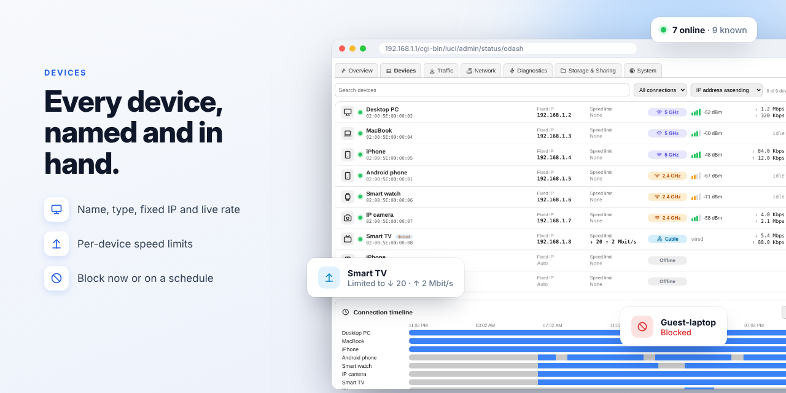
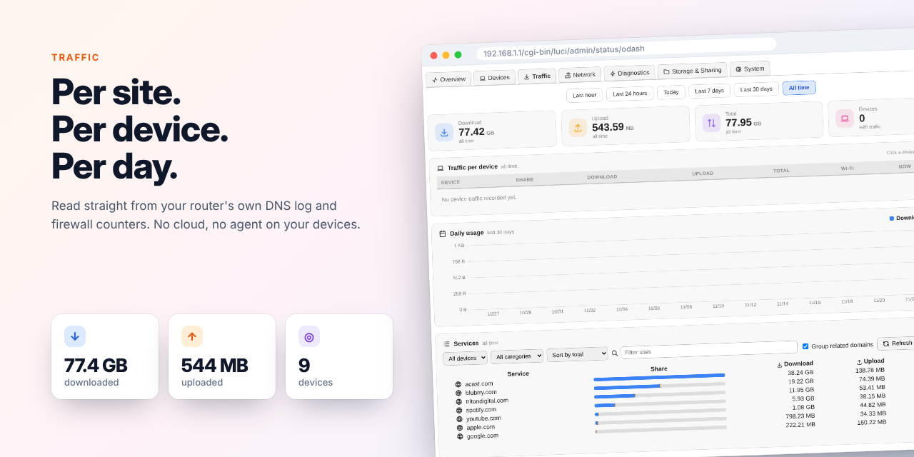

# oDash

A traffic, device and router dashboard for **OpenWrt**, built into LuCI (**Status > oDash**).
See who uses your network and what they use, control devices, and manage the router, Wi-Fi and USB storage from one page.



## Install

Run this on the router (SSH). It works on every OpenWrt architecture, because oDash is only shell, awk and JavaScript:

```sh
wget -qO- https://raw.githubusercontent.com/fzdamk/oDash/main/install.sh | sh
```

If the router has `curl` instead of `wget`:

```sh
curl -fsSL https://raw.githubusercontent.com/fzdamk/oDash/main/install.sh | sh
```

Then open LuCI and go to **Status > oDash** (use a new browser tab or press Ctrl+F5 the first time).

The installer checks that this is OpenWrt, installs missing requirements (`nftables`, `luci-base`, `logd`, `jsonfilter`, and certificates if HTTPS needs them), verifies the download with a SHA-256 checksum, and keeps your settings when you update.

Other ways:

| Need | Command |
| --- | --- |
| A specific version | `ODASH_VERSION=1.0.0 sh install.sh` |
| Update | run the install command again, or use **System > Update oDash** in the panel with a new `oDash-VERSION.tar.gz` |
| Remove, keep data | `sh install.sh uninstall` |
| Remove everything | `sh install.sh uninstall --purge` |
| Manual install | download `oDash-VERSION.tar.gz` from [Releases](../../releases), copy it to the router, `tar xzf`, then `sh odash-VERSION/install.sh` |
| Package files | the release also has `.ipk` files (`opkg install ./oDash_*.ipk ./luci-app-oDash_*.ipk`) |


## What you get



| | |
| --- | --- |
| **Overview** | live throughput, top services, online devices, uplink, system, CPU/RAM/temperature, fan and status LEDs |
| **Devices** | every device with its name, type, fixed IP, speed limit, signal and live rate; block, rename, time rules; a connection timeline for up to 7 days (click a bar to see how long it lasted) |
| **Traffic** | usage per device, per site and per category, by day, hour or all time |
| **Network** | interfaces, multi-WAN failover and load balancing, Wi-Fi radios, Wi-Fi uplink (Travelmate) |
| **Diagnostics** | speed tests, ping checks, DNS and IP leak tests, scheduled runs |
| **Storage & Sharing** | Samba shares and users, disks: format, mount, safe-remove |
| **System** | themes, fan, LEDs, time zone, panel domain, Wi-Fi and reboot schedules, scheduled backups, export/import of oDash data, update from the panel |

### Themes

Default, Sidebar, Neon console, Bento and Soft. The theme is saved in the browser; the Default theme is the plain LuCI look.

The images use made-up devices and addresses.

## Requirements

- OpenWrt with LuCI. Developed and tested on OpenWrt 25.12 (`apk`); the installer also supports `opkg`. Older releases are untested.
- Any CPU architecture (the package is architecture-independent).
- About 1.5 MB of flash. Statistics are kept in RAM and saved to flash every 5 minutes (changeable), only when something changed.
- Some features need extra packages that you may already have: Samba (`samba4-server`), Travelmate, mwan3, PassWall 2. The panel shows a card only when the feature is present.

## Privacy

- oDash keeps all its data on your router (`/etc/odash`, and `/tmp/odash` in RAM). There is no account, no telemetry and no cloud service.
- Per-site statistics come from your own router's DNS log. They are visible to whoever can open the LuCI panel, so protect LuCI with a strong password.
- The tools below contact the internet only when you use them: speed tests (Cloudflare, Speedtest.net server list), the public-IP and DNS-leak tests (ipify, ipwho.is, ip-api.com, bash.ws).
- Your **browser** (not the router) also loads small images from third parties: site icons from Google (`google.com/s2/favicons`) for the services list, country flags from `flagcdn.com` in the speed-test picker, and web fonts from Google Fonts for some themes. If that matters to you, use the Default theme and avoid the Services list on untrusted networks.

## Build from source

```sh
./release.sh        # builds dist/oDash-VERSION.tar.gz, the .ipk files and the checksums
```

Layout:

```
odash/            CLI (/usr/bin/odash), collector, init script, defaults
luci-app-odash/   LuCI views, menu entry and ACL
build-ipk.sh      builds the archives without the OpenWrt SDK
install.sh        one-command installer, updater and uninstaller
docs/img/         README images
```

## License

MIT, see [LICENSE](LICENSE).
